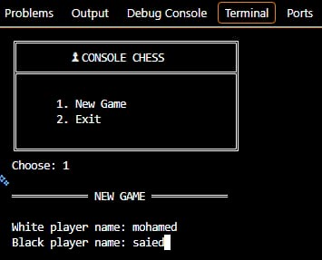
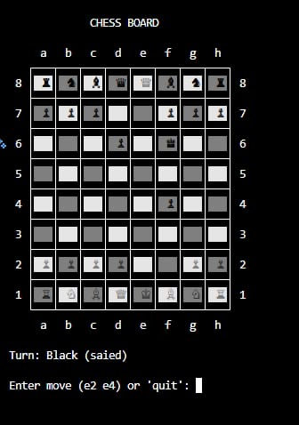

# Console Chess

A two-player chess game that runs in the terminal, written in C#.

## Screenshots

### Main Menu


### Chess Board


## How to Run
1. Clone the repository:
   ```
   git clone https://github.com/mohamed-elfrsisi/Chess_Game.git
   ```
2. Open the project in Visual Studio or VS Code
3. Run the game:
   ```
   dotnet run
   ```
4. Choose `1. New Game`
5. Enter the names of both players
6. Enter moves in this format: `e2 e4`
7. Type `quit` to exit
